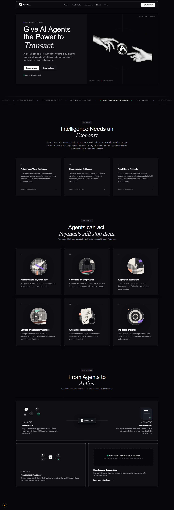
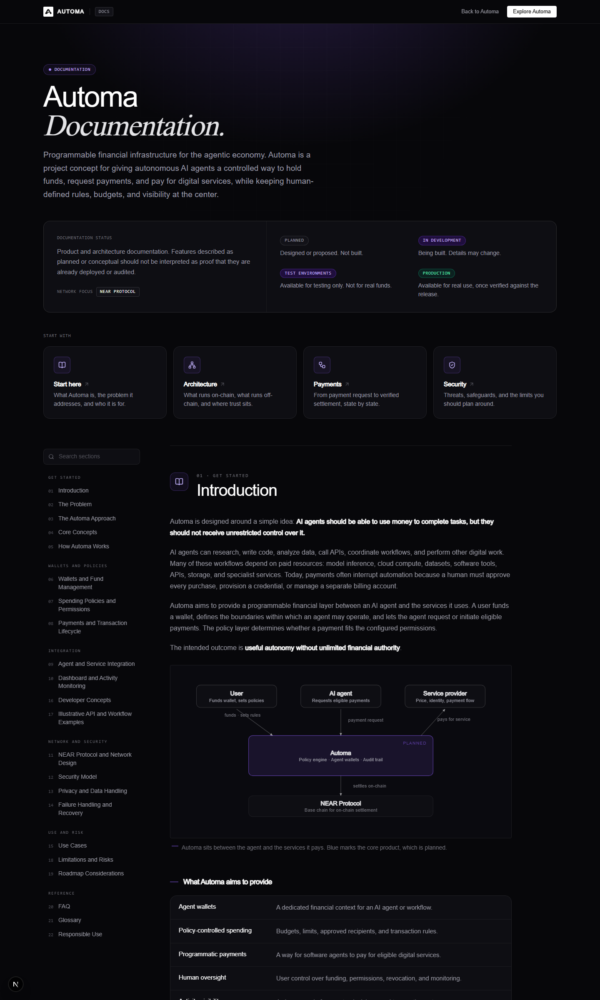
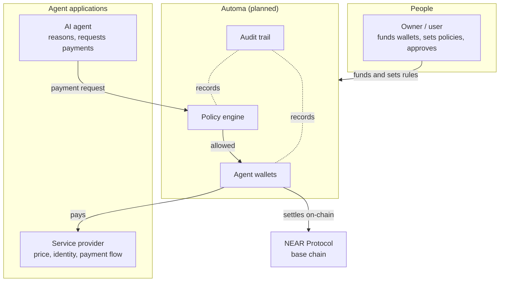
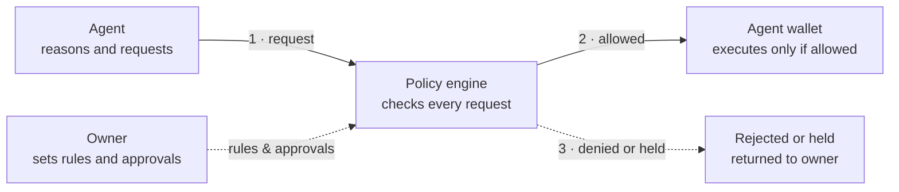
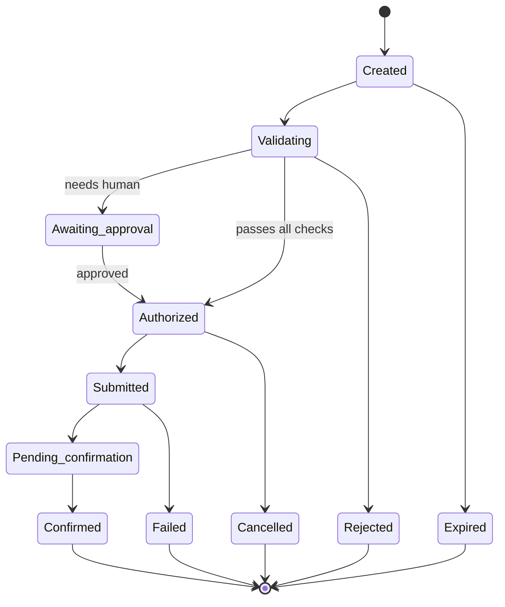
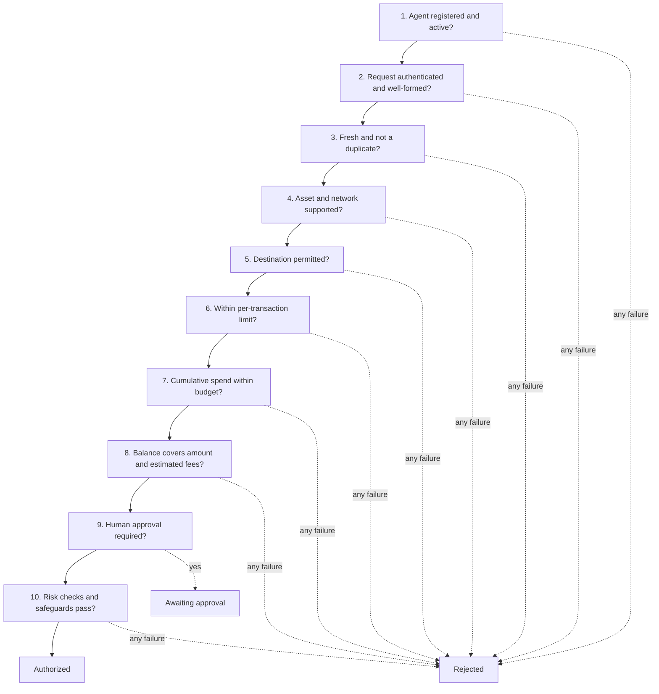
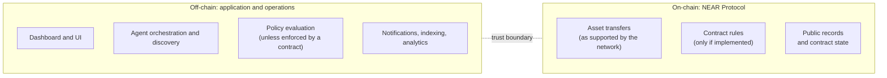
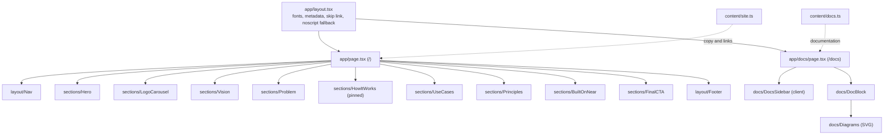

# Automa Landing Page

The marketing site and documentation for **Automa**, a project concept for programmable financial infrastructure for autonomous AI agents, built on NEAR Protocol.

This repository contains two parts:

- **Landing page** (`/`): a dark, minimal page that explains what Automa is and what it is trying to do.
- **Documentation** (`/docs`): a long-form reference covering concepts, policies, the payment lifecycle, architecture, security, the roadmap, and a glossary. It is written in the same visual language as the landing page.

> **Status.** Automa is an early-stage concept. Nothing described on the site or in the documentation should be read as a released, audited, or production-ready product. Features are labeled *Planned*, *In development*, *Test environments*, or *Production*. Nothing is marked Production in this repository.

---

## Screenshots

### Landing page



### Documentation



---

## Table of contents

1. [Features](#features)
2. [Product overview](#product-overview)
3. [Architecture](#architecture)
4. [Tech stack](#tech-stack)
5. [Getting started](#getting-started)
6. [Project structure](#project-structure)
7. [Routes](#routes)
8. [Content management](#content-management)
9. [Landing page sections](#landing-page-sections)
10. [Documentation page](#documentation-page)
11. [Motion system](#motion-system)
12. [Illustrations and assets](#illustrations-and-assets)
13. [Design system](#design-system)
14. [Accessibility](#accessibility)
15. [SEO and metadata](#seo-and-metadata)
16. [Deployment](#deployment)
17. [Known issues and open decisions](#known-issues-and-open-decisions)
18. [Roadmap](#roadmap)
19. [Contributing](#contributing)

---

## Features

- **Single-page landing** with nine sections, a sticky glass navigation, and a footer.
- **Full documentation site** at `/docs`: 22 sections, a searchable sidebar that highlights the section in view, quick-start cards, status labels, and eight diagrams.
- **Scroll-pinned storytelling** in *How It Works* on desktop. The three steps advance as you scroll.
- **Motion layer** built from CSS keyframes, scroll-driven animations, and Framer Motion reveals. Every animation has a reduced-motion fallback.
- **Works without JavaScript** for the main content. Entrance animations are CSS-only and scroll reveals are forced visible via `<noscript>`.
- **Centralized copy** in two files (`src/content/site.ts` and `src/content/docs.ts`), so text can be edited without touching components.
- **Static metadata**: Open Graph image, `robots.txt`, and `sitemap.xml`.

---

## Product overview

Automa's core idea is simple: **AI agents should be able to use money to complete tasks, but they should not receive unrestricted control over it.**

The intended model separates two things:

- The agent's **ability to request** a payment.
- The **authority to approve and execute** it.

A user funds an agent wallet, defines policies (limits, budgets, approved recipients, human approval rules), and lets the agent submit payment requests. A policy engine checks each request before anything reaches the network. Every request, decision, and outcome is recorded so the user can inspect it.

| Concept | Meaning |
|---|---|
| **Agent** | Software that performs tasks and may request eligible payments. Registration does not make it trusted. |
| **Agent wallet** | A financial context that holds only the funds allocated to agent activity. |
| **Policy** | Rules for what an agent may do: per-payment limits, budgets, recipient allowlists, approval requirements. |
| **Budget** | A spending allowance over a period or task, evaluated against prior spend and pending reservations. |
| **Payment request** | A structured proposal: amount, asset, destination, purpose, requesting agent, and a unique ID. |
| **Authorization decision** | The outcome of policy evaluation: allowed, rejected, or awaiting human approval. |
| **Transaction** | The on-chain operation, if one is submitted. A request is not a transaction. |
| **Audit trail** | The record of what happened, with secrets excluded. |

What Automa is **not**: a promise that every agent can spend freely, that every service accepts crypto, or that every payment is automatically safe.

---

## Architecture

### Layered model (conceptual)



### Reasoning versus authority



The agent never holds an unrestricted signing key in this model.

### Payment lifecycle



Only **Confirmed** means the payment has settled. Terminal outcomes such as Rejected, Failed, Expired, and Cancelled can occur before confirmation.

### Policy evaluation order



Each check must pass in order. If a required check cannot be completed, the request is rejected or sent for review. It is never silently bypassed.

### Trust boundary



A rule enforced only off-chain has different guarantees from one enforced by a contract. The documentation states which is which, section by section.

### Site structure



---

## Tech stack

| Area | Choice |
|---|---|
| Framework | Next.js 16.4.2 (App Router, Turbopack) |
| UI | React 19.3.0 |
| Language | TypeScript 5 |
| Styling | Tailwind CSS 4 (`@tailwindcss/postcss`, `@tailwindcss/turbopack`), plus CSS custom properties and utility classes |
| Motion | CSS keyframes and `animation-timeline: view()`, plus `framer-motion` 14.5.0 for reveals and the pinned steps |
| Icons | `lucide-react` |
| Utilities | `clsx` |
| Linting | ESLint 9 with `eslint-config-next` |

---

## Getting started

### Prerequisites

- Node.js 20 or newer (the project declares `@types/node` ^20)
- npm

### Install and run

```bash
cd automa-landing
npm install
npm run dev
```

Open [http://localhost:3000](http://localhost:3000) for the landing page and [http://localhost:3000/docs](http://localhost:3000/docs) for the documentation.

### Scripts

| Command | What it does |
|---|---|
| `npm run dev` | Starts the development server with Turbopack. |
| `npm run build` | Creates a production build. |
| `npm run start` | Serves the production build. |
| `npm run lint` | Runs ESLint. |
| `npx tsc --noEmit` | Typechecks the project. |

---

## Project structure

```
automa-landing/
├── public/
│   ├── collage/              Halftone collage illustrations for the Problem cards
│   ├── Automalogo.png        Wordmark mark used in the nav and footer
│   ├── near-dark.png         NEAR mark for the ticker
│   └── ...                   Other brand and hero images
├── src/
│   ├── app/
│   │   ├── layout.tsx        Fonts, metadata, viewport, skip link, noscript reveal fallback
│   │   ├── page.tsx          Landing page: composes the sections in order
│   │   ├── globals.css       Design tokens, tick-box panels, motion layer
│   │   ├── docs/page.tsx     Documentation page (/docs)
│   │   ├── opengraph-image.tsx
│   │   ├── robots.ts
│   │   ├── sitemap.ts
│   │   └── icon.png
│   ├── components/
│   │   ├── layout/           Nav.tsx, Footer.tsx
│   │   ├── sections/         Hero, LogoCarousel, Vision, Problem, HowItWorks,
│   │   │                     UseCases, Principles, BuiltOnNear, FinalCTA
│   │   ├── docs/             DocBlock.tsx, Diagrams.tsx, DocsSidebar.tsx
│   │   ├── ui/               Reveal, ScrollProgress, Button, Badge, GlassCard,
│   │   │                     IconChip, Container, Section
│   │   └── visuals/          AgentNetwork, GlowBackground
│   ├── content/
│   │   ├── site.ts           All landing-page copy, links, and navigation
│   │   └── docs.ts           All documentation content (22 sections)
│   └── lib/
│       └── cn.ts             Class-name helper
├── docs/
│   ├── screenshots/          Screenshots used in this README
│   ├── product-requirements-document.md
│   ├── software-requirements-specification.md
│   ├── technical-design-document.md
│   ├── architecture-design-document.md
│   └── backlog.md
├── AGENTS.md                 Notes for AI agents working in this repo
├── GEMINI.md                 Project context notes
└── LEARNINGS.gemini.md       Lessons from earlier iterations
```

---

## Routes

| Path | Purpose |
|---|---|
| `/` | Landing page. |
| `/docs` | Documentation. Opens in a new tab from the nav, footer, and CTAs. |
| `/opengraph-image` | Generated 1200×630 Open Graph card. |
| `/robots.txt` | Generated from `src/app/robots.ts`. |
| `/sitemap.xml` | Generated from `src/app/sitemap.ts`. Lists `/` and `/docs`. |

---

## Content management

Almost every string on the site lives in two files. Edit these, not the components.

### `src/content/site.ts`

- `name`, `title`, `description`: metadata and brand name.
- `links`: `docs`, `primaryCta`, `github`, `x`, `discord`. An empty or missing link is not rendered in the footer.
- `nav`: nav items. The item with `newTab: true` opens in a new tab.
- `hero`, `vision`, `problem`, `howItWorks`, `useCases`, `principles`, `builtOnNear`, `finalCta`, `footer`: section copy.
- Helpers: `href(key)`, `homeLink(to, onHome)` (resolves `#section` anchors to `/#section` when off the home page), and `newTabProps`.

### `src/content/docs.ts`

- `docs`: title, intro, status text, and the status legend.
- `sections`: each documentation section has an `id`, `number`, `title`, `group`, and a list of `blocks`.
- Block types: `p`, `h3`, `list`, `olist`, `defs`, `table`, `code`, `note`, and `diagram`.
- Inline markup: `**bold**` and `` `code` ``.
- The diagram block names a drawing in `src/components/docs/Diagrams.tsx`: `overview`, `separation`, `sequence`, `balance`, `policy-pipeline`, `lifecycle`, `integration`, or `trust-boundary`.

---

## Landing page sections

Order on the home page (from `src/app/page.tsx`):

| # | Section | Anchor | What it does |
|---|---|---|---|
| 1 | Navigation | `Nav` | Sticky glass bar. Links: Vision, How It Works, Use Cases, NEAR, Docs (new tab). CTA: Explore Automa. Mobile drawer. |
| 2 | Hero | `#hero` | Headline "Give AI Agents the Power to Transact.", subtitle, two CTAs, and the artwork panel. Entrance animation is CSS-only. |
| 3 | Concept ticker | (none) | An infinite, seamless ticker of the six core concepts plus "Built on NEAR Protocol". Pauses on hover. |
| 4 | Vision | `#vision` | "Intelligence Needs an Economy." with three pillars. |
| 5 | The Problem | `#the-problem` | Six cards, one per gap, each with a collage illustration. Illustrations float gently. |
| 6 | How It Works | `#how-it-works` | Connect, Enable, Transact. On desktop (768px and up) the section pins and the steps advance with scroll. Inactive steps dim while pinned. |
| 7 | Use Cases | `#use-cases` | Three potential use cases with a cursor-following glow on hover. |
| 8 | Principles | `#principles` | Eight design principles from the product specification in a four-column grid. |
| 9 | Built on NEAR | `#built-on-near` | Foundation statement and three capability pillars. |
| 10 | Final CTA | (none) | "Build for the Agentic Economy." with Explore Automa and Read the Docs. |
| 11 | Footer | (none) | Brand, CTAs, Explore and Docs link columns, a Community column (only configured links), a live "Built on NEAR" dot, back to top, and a decorative wordmark. |

---

## Documentation page

`/docs` is a separate reading experience with its own top bar.

- **Header**: wordmark, "Back to Automa", and an Explore Automa button.
- **Hero**: title, intro, documentation status panel, and the four status labels.
- **Start with**: four cards that jump to Introduction, Architecture, Payments, and Security.
- **Sidebar** (desktop): groups every section, has a search box, and highlights the section in view using `IntersectionObserver`. On mobile it becomes a collapsible menu.
- **Sections**: 22 sections in six groups: Get started, Wallets and policies, Integration, Network and security, Use and risk, Reference.
- **Callouts**: each note has an icon chosen from its label (for example, Fail closed uses a shield icon).
- **Diagrams**: eight inline SVG drawings, each with a caption. They scale with the column and scroll horizontally on small screens.

### Diagram index

| Diagram | Section | Shows |
|---|---|---|
| `overview` | 1. Introduction | User, agent, Automa, service provider, NEAR. |
| `separation` | 3. The Automa Approach | Request, policy decision, execution, and the denied path. |
| `sequence` | 5. How Automa Works | Six stages from need to record, with the actor for each. |
| `balance` | 6. Wallets and Fund Management | Wallet balance split into spent, reserved, and available, plus a daily budget. Values are illustrative. |
| `policy-pipeline` | 7. Spending Policies | Ten checks, leading to Authorized, Awaiting approval, or Rejected. |
| `lifecycle` | 8. Payments | The payment states and terminal outcomes. |
| `integration` | 9. Agent and Service Integration | Connector components, the request path, and the status path. |
| `trust-boundary` | 11. NEAR Protocol and Network Design | Off-chain and on-chain responsibilities with the trust boundary. |

---

## Motion system

The motion layer is split by technique so each part degrades on its own.

| Pattern | Where | How it is built |
|---|---|---|
| Hero entrance | Hero text | `.hero-rise` keyframes with staggered `--d` delays. Pure CSS, works without JavaScript. |
| Scroll-driven entrance | Docs sections and diagrams, BuiltOnNear feature cards | `.scroll-rise` uses `animation-timeline: view()`. Browsers without support show the content immediately. |
| Scroll reveal | Section headers and card grids | `Reveal` (Framer Motion `whileInView`), once per element, `margin: -10%`. |
| Scroll-pinned steps | How It Works (desktop only) | `useScroll` maps progress to the active step. Inactive steps dim to 40% opacity only after the section is entered. A three-segment progress bar fills with progress. |
| Marquee | Concept ticker | `.animate-marquee`, a seamless two-copy loop, paused on hover. |
| Idle float | Problem illustrations | `.float-soft`, staggered with `--i`. |
| Cursor spotlight | Use Cases cards | A radial gradient follows the pointer through `--mx` and `--my` CSS variables. |
| Micro-interactions | Buttons and links | Press scale `0.98`, arrow slides `3px` on hover. |
| Live dot | Footer "Built on NEAR" | `.live-pulse` pseudo-element. |

### Reduced motion and fallbacks

- A global `prefers-reduced-motion: reduce` rule shortens all animations and transitions to effectively zero and stops loops. Final states remain visible.
- Scroll pinning is disabled below 768px and under reduced motion (`.pin-track` and `.pin-sticky`). Steps show in normal flow.
- `Reveal` content stays visible without JavaScript because a `<noscript>` style in `layout.tsx` forces `[data-reveal]` visible.

---

## Illustrations and assets

- **Problem illustrations** (`public/collage/motif-*.png`) were drawn procedurally for this project. They are halftone dot screens built from a tone map, with accent strips and receipt slips. They are original, not copied from any other artwork.
  - `motif-agents-stop.png`: plane held over a pause mark (01 Agents can act)
  - `motif-locked.png`: padlock with a keyhole (02 Credentials too powerful)
  - `motif-budgets.png`: one allowance split into slices (03 Budgets are fragmented)
  - `motif-gears.png`: meshing gears (04 Services are not built for machines)
  - `motif-receipt.png`: receipt with a tick and a lens (05 Actions need accountability)
  - `motif-target.png`: target and arrow (06 The design challenge)
- **Brand assets**: `Automalogo.png` (mark), `near-dark.png` (NEAR mark).
- **Hero artwork**: `hsi-dark-branded.png`.

---

## Design system

Tokens are defined in `src/app/globals.css` and mirrored in `tailwind` theme variables.

| Token | Value | Use |
|---|---|---|
| `--bg` / `--color-bg` | `#07070A` | Page background |
| `--surface` | `#0E0E13` | Cards and the nav on scroll |
| `--color-surface-hover` | `#14141C` | Card hover |
| `--border` | `rgba(255,255,255,0.08)` | Dividers and card borders |
| `--text` | `#FFFFFF` | Headings |
| `--text-muted` | `#9A9AA5` | Body copy |
| `--text-dim` | `#6B6B76` | Captions |
| Accent | `#8B5CF6` (violet) | Eyebrows, focus rings, glows, highlights. Used sparingly. |

- **Type**: Inter (sans) and Playfair Display (serif, italic for the second line of headings). Loaded with `next/font/google` and `display: swap`.
- **Panels**: the "tick box" motif, with four corner registration marks, is the signature container.
- **Focus**: a 1.5px violet outline with 2px offset on `:focus-visible`.

---

## Accessibility

- Skip-to-content link as the first focusable element.
- Semantic landmarks: `header`, `nav` (with `aria-label`), `main`, `section` with labelled headings, `footer`.
- One `h1` on each page. Headings follow a logical order.
- Decorative images use `alt=""` and `aria-hidden`. The marquee's duplicate copy is `aria-hidden`.
- Mobile menu button uses `aria-expanded` and `aria-label`.
- Reduced-motion support is applied to every animation (see above).
- Touch targets are at least 44px on primary buttons.

---

## SEO and metadata

- Title: `Automa — Financial Infrastructure for the Agentic Economy`
- Description: defined in `site.ts` and used for the Open Graph and Twitter cards.
- `metadataBase` is set to `https://automa.xyz` in `layout.tsx`. The sitemap also uses this domain. **Confirm this domain before launch.**
- `robots.ts` and `sitemap.ts` are generated by Next.js.
- The docs page has its own title and description.

---

## Deployment

The project is a standard Next.js app and can be deployed to Vercel or any Node-compatible host.

```bash
npm run build
npm run start
```

Before launch, see [Known issues and open decisions](#known-issues-and-open-decisions). In particular, the placeholder links and the production domain need real values.

---

## Known issues and open decisions

These are tracked here so nothing is hidden.

- **Unverified claims on the landing page.** `Hero.tsx` shows the telemetry label "LATENCY < 800MS". `HowItWorks.tsx` shows "NEAR Testnet · Agent Key Delegation · Escrow Contracts". Neither is verified against the product. Only keep claims that the product actually supports.
- **Placeholder community links.** `site.links.github`, `x`, and `discord` are generic (`https://github.com`, `https://x.com`, `https://discord.com`). The footer renders them as "Community" links. Replace them with real Automa URLs or remove them.
- **Build and lint are not verified in every environment.** `npm run build` and `npm run lint` need to be run before deploying. Typechecking passes with `npx tsc --noEmit`.
- **Visual review.** Screenshots in this README were captured with headless Microsoft Edge at 1440px wide. Check mobile widths and reduced-motion behaviour in a real browser.
- **Domain.** `automa.xyz` is assumed in `layout.tsx`, `sitemap.ts`, and `robots.ts`.
- **External docs.** The nav's Docs link now points to `/docs` in a new tab. The earlier external `docs.automa.xyz` link is no longer used. Decide whether `/docs` or an external site is the canonical documentation.
- **Git history.** The remote `main` branch of `arg0506/Automa-landing` contains an unrelated Vite project. This work is on the `nextjs-landing` branch.
- **Partner logos.** OpenAI and Anthropic logos were removed from the ticker because they imply a partnership. Do not restore them without written permission.
- **Motion tuning.** Count-up, live-data ticker, terminal typing, chart drawing, and tab switching are intentionally not implemented, because the site has no real data for them.
- **License.** No license file has been chosen yet.

---

## Roadmap

The roadmap for Automa itself (product, not this website) is directional, and no dates are committed. From the documentation:

1. **Foundation**: reliable wallet connection, network selection, funding and balance views, agent registration and revocation, basic per-transaction and cumulative limits.
2. **Policy and oversight**: approved-recipient controls, human approval flows, budget reservations, better audit history, safe pause and emergency revocation.
3. **Developer experience**: a documented, versioned API or SDK once released, examples, webhooks or another status notification method, sandbox workflows, clear error codes.
4. **Ecosystem**: service-provider integrations, machine-readable pricing and identity, cross-agent budget management, configurable risk alerts, and additional network or asset support only after validation.

Roadmap items are marked *planned*, *in development*, *available in test environments*, or *available in production* based on verified status.

For the website, the next steps are the open decisions listed above, plus a mobile and reduced-motion visual pass.

---

## Contributing

1. Create a branch from `nextjs-landing`.
2. Make changes. Keep copy in `site.ts` and `docs.ts`.
3. Run `npx tsc --noEmit` and `npm run lint`.
4. Check the landing page at 360px, 768px, and 1440px widths.
5. Open a pull request with a short description and screenshots for visual changes.

Keep the product claims honest. If a feature is not implemented, label it *Planned* and say so in the copy.
