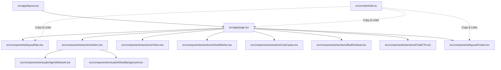

# Architecture Design Document (ADD) — Automa Landing Page

## 1. System Architecture
The application is built on Next.js 16 App Router using React 19 and Tailwind CSS.

## 2. Component Design & Boundaries
- **Server Components (Default)**: `page.tsx`, `Hero.tsx`, `Vision.tsx`, `HowItWorks.tsx`, `UseCases.tsx`, `BuiltOnNear.tsx`, `FinalCTA.tsx`, `Footer.tsx`. These require zero client JavaScript runtime overhead.
- **Client Components (`"use client"`)**:
  - `Nav.tsx`: Manages scroll listeners for sticky glass transition, escape key listener, and mobile navigation drawer state.
  - `Reveal.tsx`: Wraps elements with intersection observers and motion animations.
  - `AgentNetwork.tsx`: Runs lightweight requestAnimationFrame pulse sequences and node drifting.

## 3. Styling & Token System
- Design tokens are defined in `globals.css` as CSS custom properties (`--bg`, `--surface`, `--violet-*`).
- Utility classes utilize Tailwind variables with fallback defaults.
- Glassmorphism effects apply `backdrop-blur-md` alongside inset box shadows (`box-shadow: inset 0 1px 0 rgba(255, 255, 255, 0.06)`).
